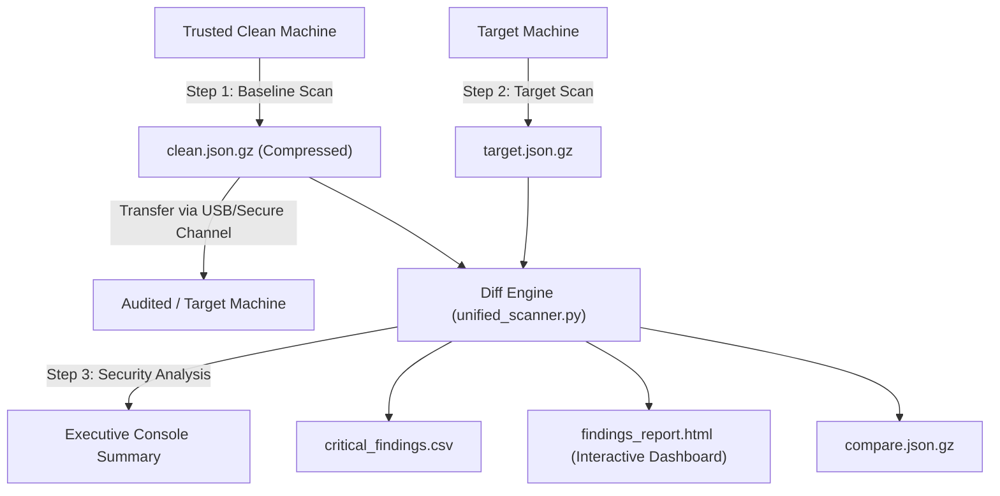

# Unified Filesystem Scanner and Integrity Checker (v2.0 Forensic Edition)

An agentless, cross-platform (Windows & Linux) filesystem auditing and forensic differential analysis tool. It captures system state snapshots (file sizes, modification timestamps, POSIX permissions, MD5, and SHA-256 hashes) and compares them against a known-good baseline to detect unauthorized modifications, malware drops, backdoors, and tampered system binaries.

---

## ⚡ Key Capabilities

- **Zero Third-Party Dependencies:** Written in standard Python 3.7+ (`hashlib`, `multiprocessing`, `json`, `csv`, `gzip`, etc.). No `pip install` required.
- **Dual-Stream Forensic Hashing (MD5 + SHA-256):** Computes both MD5 and SHA-256 hashes in a single 128 KB buffer pass for maximum disk throughput and forensic admissibility.
- **Transparent Gzip Compression (`.json.gz`):** Shrinks snapshot storage by 80–90% (e.g. from 77 MB down to ~8 MB) with automatic `.json` and `.json.gz` loading.
- **Interactive HTML Dashboard:** Generates a standalone, responsive `findings_report.html` dashboard featuring KPI cards, real-time search, severity filters, and status selectors (zero external CDNs or internet connection needed).
- **Cross-Username Normalization:** Automatically maps `/home/<username>/` and `C:\Users\<username>\` to a generic `USER` placeholder. This enables baseline comparisons between two machines even if their usernames differ.
- **Automated Threat Detection:**
  - **SUID Privilege Escalation (`CRITICAL`):** Detects files that gained SUID root execution bits (`chmod 4755`) on Linux/Unix.
  - **Modified System Binaries (`CRITICAL`):** Flags modified files residing in critical system paths (`/bin/`, `/usr/bin/`, `C:\Windows\System32`, etc.).
  - **Suspicious New Files (`HIGH` / `CRITICAL`):** Flags executable scripts (`.sh`, `.exe`, `.py`, `.ps1`, `.bat`, `.elf`, etc.) and hidden files dropped in temporary/world-writable directories (`/tmp/`, `/dev/shm/`, `AppData\Local\Temp`, etc.).
- **Dual Operating Modes:** Run interactively via a clean terminal menu or headlessly using CLI flags for automation and incident response pipelines.
- **Comprehensive Reporting:** Outputs an executive terminal summary, a structured CSV report (`critical_findings.csv`), an interactive HTML report (`findings_report.html`), and full machine-readable diff JSON.

---

## 📋 Prerequisites

- **Python 3.7+** (Works on Windows 10/11, Windows Server, and any Linux distribution).
- **Permissions:**
  - **Linux:** Run with `sudo` if you need to read privileged system directories.
  - **Windows:** Run in an Administrator terminal to access protected system directories.

---

## 🚀 Quick Start Guide

### 1. Interactive Menu Mode

Simply run the script with no arguments:

```bash
python unified_scanner.py
```

You will be presented with the menu:

```text
===========================================================================
          UNIFIED FILESYSTEM SCANNER AND INTEGRITY CHECKER (v2.0)          
===========================================================================
  1. Create Clean Baseline Scan (clean.json or clean.json.gz)
  2. Scan Target, Compare with Baseline, and Generate CSV + HTML Reports
  3. Scan Baseline & Target Sequentially (Benchmark / Demo)
  4. Compare Two Existing JSON Scan Files (Generate Reports)
  5. Inspect / View a Scan or Comparison JSON File
  6. Export Interactive HTML Report from an Existing Diff JSON
  7. Exit
===========================================================================
```

---

### 2. Command-Line / Headless Automation

You can also run tasks directly from scripts or CI/CD pipelines:

#### Create a Baseline Snapshot
```bash
# Scan default system drive and save to clean.json
python unified_scanner.py --baseline

# Create a compressed baseline snapshot (saves ~85% disk space)
python unified_scanner.py --baseline --compress

# Scan a specific directory
python unified_scanner.py --baseline --path /var/www --compress
```

#### Audit a Target System against Baseline
```bash
# Scans target, automatically locates clean.json / clean.json.gz, compares, and outputs reports:
python unified_scanner.py --target

# With compression enabled:
python unified_scanner.py --target --compress
```

#### Compare Two Existing Scan Files
```bash
python unified_scanner.py --compare baseline.json.gz target.json.gz --output-csv findings.csv --output-html report.html
```

#### Inspect a Scan or Diff File
```bash
python unified_scanner.py --view clean.json
```

---

## 🔍 Incident Response Workflow



1. **Step 1: Capture Baseline**
   - Run `python unified_scanner.py --baseline --compress` on a freshly installed, known-good reference system.
   - This generates `clean.json.gz`.
2. **Step 2: Transfer Baseline to Target Machine**
   - Copy `clean.json.gz` and `unified_scanner.py` to the machine you wish to audit.
3. **Step 3: Run Audit Scan**
   - Run `python unified_scanner.py --target`.
   - The scanner hashes the target filesystem (MD5 + SHA-256), matches paths using username normalization, and isolates discrepancies.
4. **Step 4: Review Reports**
   - Review the immediate terminal summary.
   - Double-click `findings_report.html` to open the interactive visual dashboard in your web browser.
   - Ingest `critical_findings.csv` into your SIEM or spreadsheet for triage.

---

## 🛡️ Severity & Categorization Rules

| Category | Severity | Detection Criteria |
| :--- | :---: | :--- |
| **SUID Privilege Escalation** | `CRITICAL` | File gained SUID root execution bit (`chmod u+s` / `04000`) on Linux. |
| **Modified System Binary** | `CRITICAL` | File path matches system binary directories (`/bin/`, `/usr/bin/`, `System32`) and hash differs from baseline. |
| **Suspicious New File** | `CRITICAL` | New executable located in system binary directories. |
| **Suspicious New File** | `HIGH` | New file with executable/script extension (`.sh`, `.exe`, `.py`, `.ps1`, `.bat`, `.elf`, etc.) or located in temp drop zones (`/tmp/`, `Temp`). |
| **Modified File** | `MEDIUM` | Non-binary file whose SHA-256/MD5 hash changed between baseline and target. |
| **Deleted File** | `MEDIUM` | File exists in baseline snapshot but is missing from target machine. |
| **New File** | `LOW` | Regular new file not matching suspicious criteria. |

---

## 🔒 Privacy & Local Data Policy

- `clean.json`, `clean.json.gz`, `target.json`, `compare.json`, and generated CSV/HTML audit logs contain filenames, paths, and metadata specific to your machines.
- **These files are strictly ignored by `.gitignore`** and will never be committed or uploaded to GitHub.
- Keep your baseline `clean.json` / `clean.json.gz` saved locally in this directory.

---

## 🔄 Keeping Local Code Synced with GitHub

Whenever you edit or improve `unified_scanner.py` or `README.md`, sync your changes:

```powershell
# 1. Check which files changed (clean.json is ignored automatically)
git status

# 2. Stage updated files
git add unified_scanner.py README.md

# 3. Commit with a message
git commit -m "Add dual-hashing, gzip compression, and interactive HTML dashboard"

# 4. Push to GitHub
git push
```
