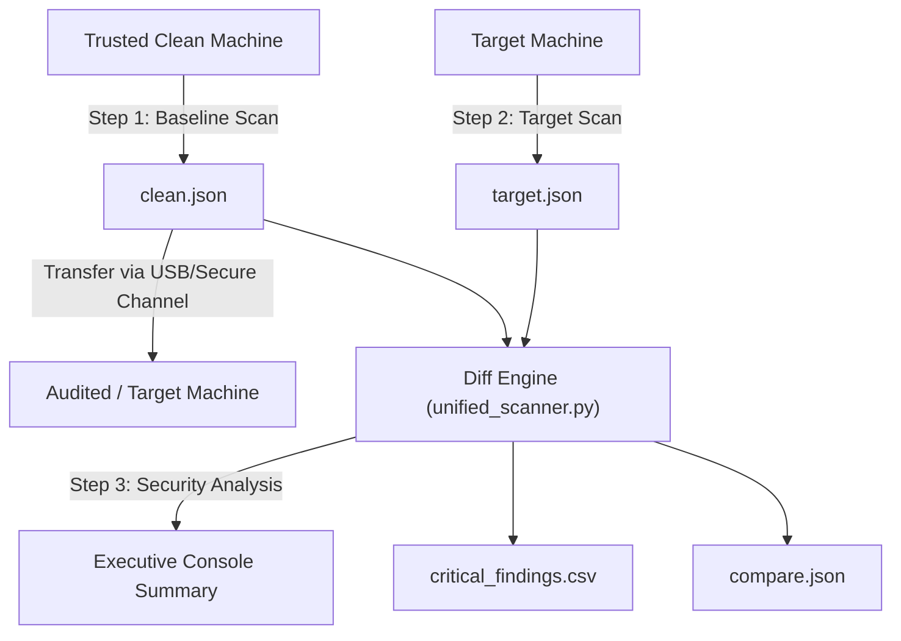

# Unified Filesystem Scanner and Integrity Checker

An agentless, cross-platform (Windows & Linux) filesystem auditing and forensic differential analysis tool. It captures system state snapshots (file sizes, modification timestamps, and MD5 hashes) and compares them against a known-good baseline to detect unauthorized modifications, malware drops, backdoors, and tampered system binaries.

---

## ⚡ Key Capabilities

- **Zero Third-Party Dependencies:** Written in standard Python 3.7+ (`hashlib`, `multiprocessing`, `json`, `csv`, etc.). No `pip install` required.
- **High-Performance Parallel Hashing:** Uses chunked multiprocessing (128 KB buffer) across CPU cores for scanning speed on massive filesystems.
- **Cross-Username Normalization:** Automatically maps `/home/<username>/` and `C:\Users\<username>\` to a generic `USER` placeholder. This enables baseline comparisons between two machines even if their usernames differ.
- **Automated Threat Detection:**
  - **Modified System Binaries (`CRITICAL`):** Flags modified files residing in critical system paths (`/bin/`, `/usr/bin/`, `C:\Windows\System32`, etc.).
  - **Suspicious New Files (`HIGH` / `CRITICAL`):** Flags executable scripts (`.sh`, `.exe`, `.py`, `.ps1`, `.bat`, `.elf`, etc.) and hidden files dropped in temporary/world-writable directories (`/tmp/`, `/dev/shm/`, `AppData\Local\Temp`, etc.).
- **Dual Operating Modes:** Run interactively via a clean terminal menu or headlessly using CLI flags for automation and incident response pipelines.
- **Comprehensive Reporting:** Outputs an executive terminal summary, a structured CSV report (`critical_findings.csv`), and full machine-readable diff JSON.

---

## 📋 Prerequisites

- **Python 3.7+** (Works on Windows 10/11, Windows Server, and any Linux distribution).
- **Permissions:**
  - **Linux:** Run with `sudo` if you need to read privileged system directories.
  - **Windows:** Run in an Administrator terminal to access protected system directories.

---

## 🚀 Quick Start Guide

### 1. Interactive Menu Mode

Simply run the script with no arguments:

```bash
python unified_scanner.py
```

You will be presented with the menu:

```text
===========================================================================
             UNIFIED FILESYSTEM SCANNER AND INTEGRITY CHECKER              
===========================================================================
  1. Create Clean JSON file (Baseline Scan)
  2. Scan Target, Compare with Baseline, and Generate Reports
  3. Scan Baseline & Target Sequentially (Full Benchmark)
  4. Compare Two Existing JSON Files
  5. Inspect / View a Scan or Comparison JSON File
  6. Exit
===========================================================================
```

---

### 2. Command-Line / Headless Automation

You can also run tasks directly from scripts or CI/CD pipelines:

#### Create a Baseline Snapshot
```bash
# Scan default system drive and save to clean.json
python unified_scanner.py --baseline

# Or scan a specific folder
python unified_scanner.py --baseline --path /var/www
```

#### Audit a Target System against Baseline
```bash
# Scans target, automatically locates clean.json, compares, and outputs reports
python unified_scanner.py --target
```

#### Compare Two Existing Scan Files
```bash
python unified_scanner.py --compare baseline.json target.json --output-csv findings.csv --output-json diff.json
```

#### Inspect a Scan or Diff File
```bash
python unified_scanner.py --view clean.json
```

---

## 🔍 Incident Response Workflow



1. **Step 1: Capture Baseline**
   - Run `python unified_scanner.py --baseline` on a freshly installed, known-good reference system.
   - This generates `clean.json`.
2. **Step 2: Transfer Baseline to Target Machine**
   - Copy `clean.json` and `unified_scanner.py` to the machine you wish to audit.
3. **Step 3: Run Audit Scan**
   - Run `python unified_scanner.py --target`.
   - The scanner hashes the target filesystem, matches paths using username normalization, and isolates discrepancies.
4. **Step 4: Review Reports**
   - Review the immediate terminal summary.
   - Open `critical_findings.csv` in Excel or ingest it into your SIEM/LLM for triage.

---

## 🛡️ Severity & Categorization Rules

| Category | Severity | Detection Criteria |
| :--- | :---: | :--- |
| **Modified System Binary** | `CRITICAL` | File path matches system binary directories (`/bin/`, `/usr/bin/`, `System32`) and hash differs from baseline. |
| **Suspicious New File** | `CRITICAL` | New executable located in system binary directories. |
| **Suspicious New File** | `HIGH` | New file with executable/script extension (`.sh`, `.exe`, `.py`, `.ps1`, `.bat`, `.elf`, etc.) or located in temp drop zones (`/tmp/`, `Temp`). |
| **Modified File** | `MEDIUM` | Non-binary file whose MD5 hash changed between baseline and target. |
| **Deleted File** | `MEDIUM` | File exists in baseline snapshot but is missing from target machine. |
| **New File** | `LOW` | Regular new file not matching suspicious criteria. |

---

## 🔒 Privacy & Local Data Policy

- `clean.json`, `target.json`, `compare.json`, and generated CSV audit logs contain filenames, paths, and metadata specific to your machines.
- **These files are strictly ignored by `.gitignore`** and will never be committed or uploaded to GitHub.
- Keep your baseline `clean.json` saved locally in this directory.

---

## 🔄 Keeping Local Code Synced with GitHub

### Initializing and Pushing to GitHub (First Time)

1. Initialize git and commit the project files:
   ```bash
   git init
   git add unified_scanner.py README.md .gitignore
   git commit -m "Initial commit: Unified Filesystem Scanner and Integrity Checker"
   ```

2. Link your GitHub repository and push:
   ```bash
   git branch -M main
   git remote add origin https://github.com/G777216/Baseline.git
   git push -u origin main
   ```

### Daily Sync Workflow (When you update local code)

Whenever you edit or improve `unified_scanner.py` or `README.md`, sync your changes:

```bash
# 1. Check which files changed (clean.json is ignored automatically)
git status

# 2. Stage updated files
git add unified_scanner.py README.md

# 3. Commit with a message
git commit -m "Update scanner features and optimizations"

# 4. Push to GitHub
git push
```

To pull updates from GitHub if edited elsewhere:
```bash
git pull origin main
```

